# DonWells Cue — Operator's Manual

**Version:** 2.6.23 development
**Source revision:** 1ae8427d593da3247b43aa4c4d4abfc620f63f93
**Native engine baseline:** 7c233a9
**Edition:** 15 November 2026 · English · Operator edition

A practical handbook for the person preparing and running audio cues in a live show. Includes same-machine video output, remote control, recovery procedures, and printable checklists.

This development edition covers docked controls, live group shuffle, group levels, the QuickPlay handoff to Up Next, backup music, picture framing, and the pre-show video check.

The interface captures use practice media and software audio output. **docs/manual-assets/captures.json** records each capture's date, source revision and hash. Equipment photographs remain illustrative.

## 1. Read this before the show

### What DonWells Cue does

DonWells Cue plays prepared audio cues for theatre, conferences, live events, and installations. A playlist holds the planned sequence. QuickPlays provide independent quick-play copies for stings and effects. You can prepare trims, fades, loops, and transitions, then use Show Mode for performance.

The desktop app is the controller. A separate audio engine reads the media, runs the cues, and drives the sound device. In normal local operation both run on the same computer. In a network setup the engine runs on the computer connected to the sound system. The sound does not come from the remote controller's browser or speakers merely because it displays the meters.

<!-- diagram:signal-flow -->

The Video Output window is a separate picture renderer on the desktop computer. Its video element is muted; the audio engine remains the source of the soundtrack. A same-machine arrangement is recommended; chapter 9 explains where the picture appears when the audio engine is remote.

### The four operating rules

1. **Confirm the next target before GO.** Read the cue name beside **Play Next** and look for the **Up Next** marker. Selection, an armed target, and a playing cue are different states.
2. **Rehearse what happens at the end.** Imported cues can have **Play Next** end behavior and **Stop All Other Cues** ducking. Do not assume every new cue stops and waits, or that firing a sting leaves a bed running.
3. **Treat Preview as a real output.** Choose a separate headphone or monitor output. Sending Preview to the same physical speakers as Main makes it audible to the audience even though its device ownership is safely shared.
4. **Preserve a known-good show.** Save a rehearsal copy, keep the media with it, and test the exported copy before travel. Autosave is not a versioned backup.

> **CAUTION — Stop is not necessarily instant.** The **Stop All Cues** button and the default **Escape** shortcut use the project's Stop All fade. The default is 1 second; 0 means immediate. Rehearse the configured behavior and know the venue's independent console mute or other emergency-silence procedure.

### Language and terminology

This manual uses the English labels. Change language through **Settings → User Interface → Language** or the desktop **View → Language** menu. That preference belongs to the device, not to the show. The app includes 21 languages and right-to-left layouts for Arabic, Persian, and Urdu.

**Settings → User Interface → Show tooltips** controls hover hints in the workspace and detached QuickPlays. It starts on and is saved on this device. The audience Video Output window always runs without tooltips. **View → Change Accent Color** opens this tab, where the accent swatches apply to the current show.

| Term | Meaning in this manual |
| --- | --- |
| Show / project | The cue document saved natively as a `.dwcue` file, together with its media and related assets. |
| Cue | An audio item, including an item whose media also contains video. |
| Selected | The item you are inspecting or editing; selection alone is not a play command. |
| Up Next | The displayed target for the next GO, chosen automatically or by an explicit Set As Next override. |
| GO | The **Play Next** action; Space is its default shortcut. |
| QuickPlay | An independent quick-play copy in the QuickPlays bank. |
| Engine / server | The process that owns audio playback and the active project. |
| Portable archive | A ZIP-based `.dwcuepack` export containing one active show and the files in its dedicated project folder. |

## 2. First setup and a safe first cue

### Install and prepare the computer

Get the installer for your operating system and architecture from the [official releases page](https://github.com/donwellsav/dwcue/releases). Check its release notes against this manual's source edition. Do not update the app, operating system, audio driver, or show files immediately before a performance without rehearsal.

The Linux x86_64 packages require glibc 2.43 or newer. They were tested on Ubuntu 26.04.

When a newer release is available, the desktop app shows a five-second header notice and leaves an **Update Available** indicator. Open **Settings → About** to check for updates or choose **Download Update**. On the welcome screen, choose **Update Available** or use **Help → Check for Updates**. macOS, Windows, and Linux AppImage builds can install in place. DEB and RPM builds open the downloads page. After download, stop playback and Preview and exit Show Mode to use **Install Now**. Choose **Install on Exit** to apply the update on the next app quit. Download and installation each require an operator action.

Connect the audio interface before opening the show. Confirm the correct outputs at the sound console, start with a conservative listening level, connect mains power, and disable sleep for the performance using the operating system's controls. Prevent notification sounds from reaching the audience. Keep a separate copy of the show and its media on reliable storage.

On launch, the desktop normally starts its managed local server automatically. The welcome screen indicates **Using local server on this computer** once connected. If the engine is starting, wait for connection rather than repeatedly reopening the app. The **Connect to a server on the network…** option reveals remote setup; see chapter 10 before using it.

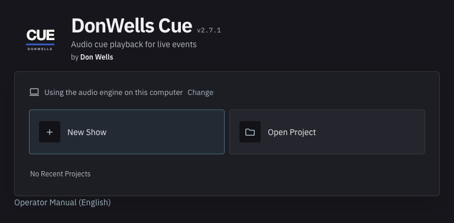

**Procedure — establish a known starting state**

- **Prerequisites:** The intended audio interface is connected, the console channel is muted or at a safe test level, and you know whether this is a local or remote-engine show.
- **Actions:** Launch DonWells Cue once. Wait for the status to settle. Read the connection mode and server identity; do not infer them from which computer holds the mouse.
- **Expected visible outcome:** The welcome screen reports the intended local server, or the remote server you explicitly selected, as connected.
- **Common mistake:** Opening a show while the status is still changing, then treating missing device or media state as a project fault.
- **Recovery:** Wait for a stable connection. If the intended server is wrong, use **Change** and follow chapter 10 before opening any show.

### Create a show

1. On the welcome screen choose **New Show**, or use **File → New Project** while a show is open. The form opens in the lower panel.
2. Enter a descriptive **Show name**, such as `Evening Show - rehearsal`.
3. Beside **Location**, choose **Choose…**. Location is a read-only summary, not a text field.
4. In the folder picker, navigate to the destination. You may type an absolute path in its path bar and press Enter. Choose **Select folder**.
5. Back in the combined name/location form, check both values and choose **Create Show**.

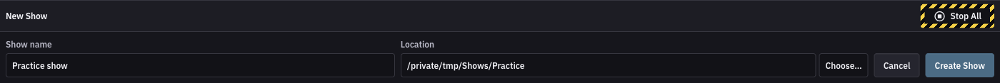

**Expected result:** After the new file is saved, the workspace opens with the new show name and an empty playlist. Canceling or a failed write leaves any current show playing. If the selected name already exists in that folder, choose a different name or folder.

The playlist, GO, and **Stop All Cues** stay available while you enter the name, choose a folder, or wait for the engine to save the new file. **Escape** stops playback and keeps the panel open. If the deadline passes before the engine accepts the switch, the current show stays active. When a late save is confirmed, the form shows the saved `.dwcue` path. Close the form and use **File → Open Project** when you are ready. If the reply is lost, let the controller verify the active show and check for the file before retrying.

DonWells Cue creates `<show name>.dwcue` and `media/` in the selected folder; portable exports use `.dwcuepack`. Keep that folder dedicated to the show. A remote picker uses the engine computer. See chapter 11 for archive import and non-overwrite safeguards.

<!-- pagebreak -->

### Make the first cue deliberately manual

1. Choose **Import Media**, then **Choose files…**, and select a short, familiar audio file.
2. Wait for import and audio readiness; a listed file may not yet be decoder-ready.
3. Open the cue's **Edit** control. In **Basic Info**, set **End Behavior** to **Nothing** for this first exercise. Review **Ducking** before playing other cues alongside it.
4. Open **Settings** and select the intended **Audio Device**. Check the device name at the main output strip. Use the cue's **Output** tab only if it needs a specific output override.
5. Close the properties panel. Check the name beside **Play Next**. If it is not the intended cue, use that row's **Set As Next** control and confirm the displayed target.
6. With the sound system at a safe level, choose **Play Next** once. Confirm the correct active cue, moving time, meters, and actual sound at the intended output.
7. Choose **Stop All Cues**. Observe its fade and verify that all active cues stop.
8. Save through **File**. Reopen during rehearsal and recheck media and device selection.

> **CHECK — Meters are not the whole signal path.** A moving playhead proves transport; a meter proves a signal at that meter. Neither proves the console input, amplifier, loudspeaker, or headphone destination is correct. Listen at the actual destination.

## 3. Find your way around the workspace

### Edit Mode

Use Edit Mode to import, organize, and configure the show. The top bar contains Settings, Video Output, Level Check, Autosave, and the Show Mode switch. Open **Settings → Shortcuts** for the keyboard reference and editor. While a Settings tab has focus, Left and Right move between tabs and Enter opens the focused tab. Transport sits below the top bar with **Stop All Cues**, the active-cue area, and **Play Next**. The button shows the cue name on multiple lines, its number, and the playable duration. A wider window has room for cue type, group, and loop or group start behavior where applicable. Hover for the full name. The output strip shows the selected device, main level, meters, and true-peak limiter.

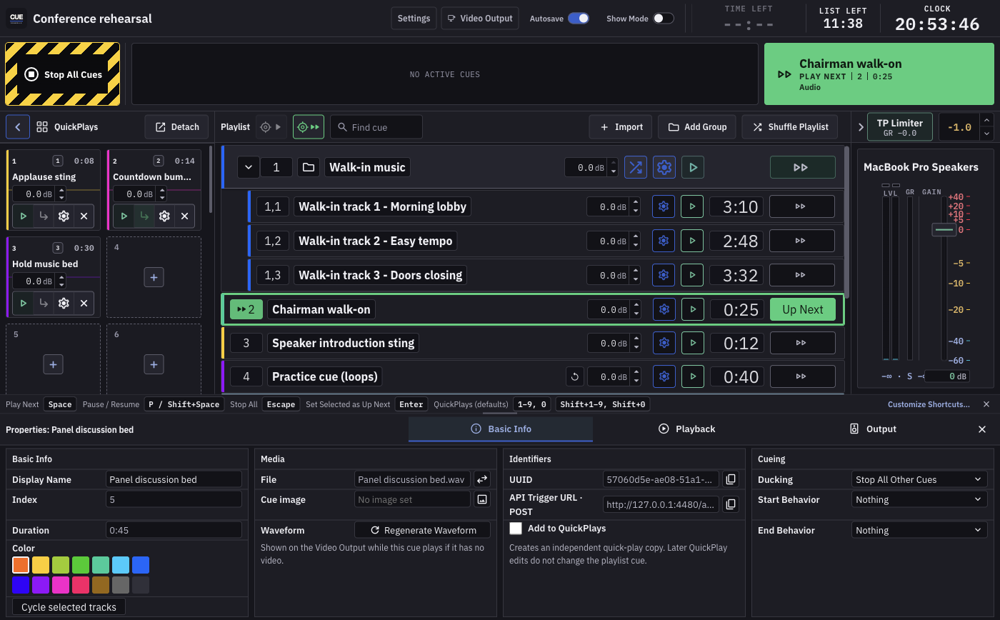

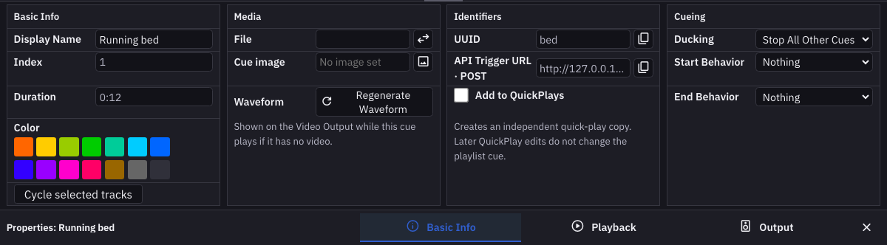

**Procedure — inspect a cue without firing it**

- **Prerequisites:** Edit Mode is active and no text editor or modal covers the playlist.
- **Actions:** Select the cue, press **Shift+S** or choose **Edit**, and read **Basic Info**. Compare its display name and index with the playlist row. Read **End Behavior** before changing it.
- **Expected visible outcome:** Properties names the selected cue while transport independently continues to show the acknowledged **Play Next** target.
- **Common mistake:** Assuming the open Properties panel means this cue is armed.
- **Recovery:** Close or leave Properties unchanged, use **Set As Next** on the intended row, and wait until **Play Next** shows the intended name.

The cue row provides **Set As Next**, **Preview**, **Play**, **Edit**, and **Delete** controls in Edit Mode. Hover for the current tooltip rather than relying on icon shape alone. **Play** fires a cue directly; **Set As Next** requests a manual GO override without playing it. The displayed target changes only after the engine acknowledges the request; a refusal or lost connection leaves the prior target authoritative. The **Edit** control opens **Properties**, with **Basic Info**, **Playback**, and **Output** tabs.

The cue row's **Delete** button and a bulk keyboard delete open **Delete Items** in the lower panel. Check the cue name or selection count before confirming. Changing the selection leaves the original confirmation targets intact. The playlist, GO, and Stop All remain available. A single selected cue can still be removed directly with the Delete key.

An empty QuickPlays bank is collapsed by default. Press **Q** or choose **Show QuickPlays** to reveal it. Assigning a cell can reveal the bank automatically unless you have explicitly chosen its visibility. Playback and shortcut assignments stay active when the bank is collapsed. On a narrow workspace, the bank and playlist share the available width.

On narrow playlists, cue names appear above the row controls and the toolbar uses icons. Hover over an icon for its label when tooltips are enabled. The header can show the full silence countdown alongside a notice.

### Show Mode

Switch to **Show Mode** for performance after preparation is complete. It simplifies the interface and emphasizes transport and large cue controls. GO and assigned controls remain live. The QuickPlay Play/Stop button and keyboard and MIDI triggers work the same way in both modes. Use Edit Mode to change the bank.

Rehearse at the actual display size and app zoom. Settings, Properties, QuickPlay Settings, and imports share the lower panel. It fits the content up to 60% of the window, with room reserved for the playlist. On a short window the panel may scroll sooner. Tabs stay along the bottom while the controls scroll. Drag the top grip down for more playlist room or up for more controls. You can also focus the grip and use **Up/Down**. Each panel remembers its adjusted height while the app is open. GO and Stop All stay at the top and the shortcut bar shows a compact reference. **Customize Shortcuts…** opens the full editor.

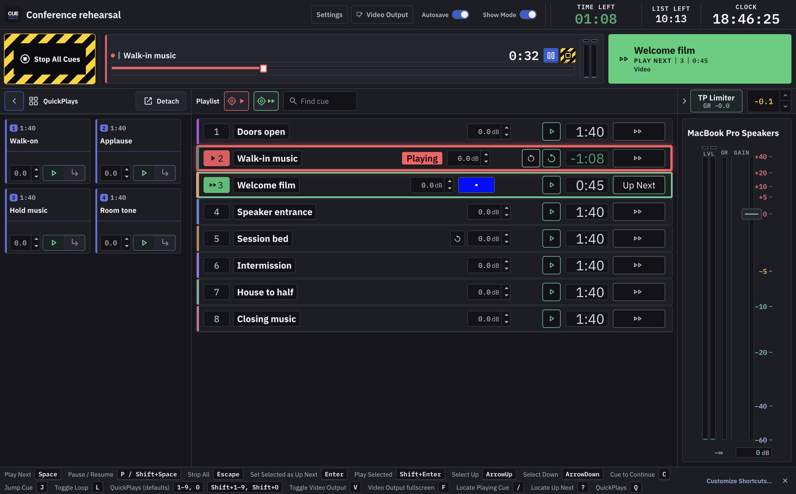

### Selection is not arming

Selection and arming are independent. Move through the playlist with **Up/Down**, then press **Enter** to set the selected cue as **Up Next**. Wait for its name beside **Play Next**, then press **Space** to run it. The row's **Set As Next** button also sets an explicit GO target. Pressing that button again on the armed row requests clearing the override.

The playlist marks the current GO target **Up Next**, including a follow target during playback. GO waits while it says **Setting Up Next…**. When it says **No cue queued**, choose a cue and set it as **Up Next**. **Stop All Cues** stays available in either state.

Choose **Locate Up Next**, the crosshair beside **Playlist**, to bring that queued row into view. Folded groups open temporarily so you can inspect the target while continuing to work with your selected cue. The button becomes available when GO has a playlist target.

Click a cue title to switch between the cue name and its media filename. The click also selects the row in the editing workspace. The original cue name is still used for Play Next and saved with the show.

Automatic Up Next defaults on. Opening prepares the first playable item; stopping a cue with **End Behavior: Nothing** prepares its next sibling. A natural end at the top-level list’s end can wrap to the first item. Preparation waits for a deliberate GO unless an authored automatic action applies. An explicit override takes precedence.

Accepted GO consumes an override and refused GO retains it. Check readiness, errors and connection before retrying. **Stop All Cues** and Panic remain available during preparation. Repeated GO input shares the pending confirmation. If it times out, check live state before pressing again.

**Stop All Cues** cancels a GO still preparing media. With the current engine, it also rejects cue starts sent before Stop All that were still waiting in the control socket. Correct the cause, confirm **Play Next** and press GO deliberately. Playing cues keep the configured Stop All fade. A fade of 0 is immediate.

## 4. Import and protect the media

### Local files first

Open **Import Media** from the playlist. For a local engine, **Choose files…** and **Choose folder…** both open in the lower panel. Use **Add** to stage selected files. Choosing a folder stages supported files from it and its subfolders in filename order. Use **Select all** or **Select none** to adjust the batch. **Import as group** puts the selected cues in a group named for the folder.

If a subfolder cannot be read, its relative path appears in a warning. The readable files remain available to import. Restore access and select the skipped subfolder separately if the show needs its files.

The **Import plan** shows file handling and duplicate settings beside the selection. **Cancel** while browsing or scanning keeps the staged batch. The playlist, GO and **Stop All Cues** stay available, and **Escape** stops cues without discarding the selection.

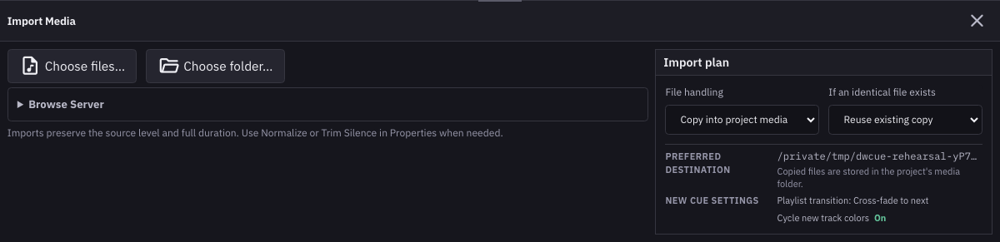

Double-click a folder or press **Enter** on it to browse. Use **Select all**, **Select none**, Shift or Ctrl/Cmd-click to select files before choosing **Add**. Select **Import selected** in the review to start verification.

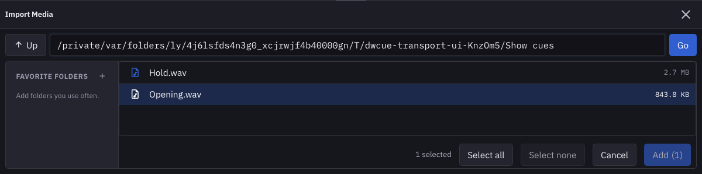

With a remote engine, drop files or one folder into **From This Computer** in the lower panel. You can paste if the clipboard supplies files. **Cancel** while reading a folder keeps the staged selection. After upload, use **Select all**, **Select none**, or **Import as group** to review the batch. **Browse Server** selects files already accessible to the engine.

During verification, the panel shows the current file, a progress bar, and **Cancel import**. If an individual file fails to upload, the remaining uploads continue. Review the failed filenames and use **Retry Failed** for those files. Retrying a group batch puts newly verified files in the same group. Reopen **Import Media** to return to the results for this show.

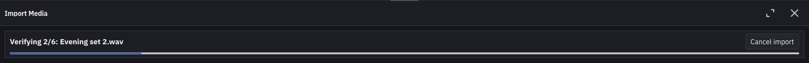

### Copy or link deliberately

The import plan starts with **Copy into project media** and **Reuse existing copy**. Choose different options in the plan when needed.

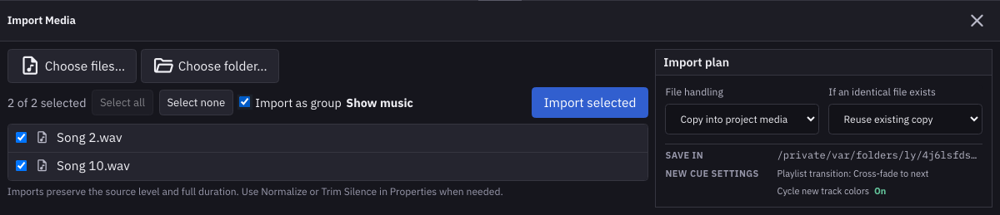

**Procedure — import media that will travel with the show**

- **Prerequisites:** The show is saved in a dedicated folder and the source files are authorized, stable, and available for audition.
- **Actions:** Choose **Import Media → Choose files…**, select the sources, then choose **Add**. Confirm **Copy into project media** and the duplicate policy in the **Import plan**. Start the import and wait for every result.
- **Expected visible outcome:** Each wanted file reports a successful import and appears as a cue; the project media folder contains the copied source.
- **Common mistake:** Choosing a link to save time, then moving only the `.dwcue` file to another machine.
- **Recovery:** Re-import with copying enabled or replace the cue media, save, export a `.dwcuepack`, and rehearse with the original source volume unavailable.

| Choice | Operational consequence |
| --- | --- |
| Copy into project media | The show has a local media copy in its `media/` folder. Saved paths for copied media are relative to the show folder, making the folder easier to move as a unit. |
| Link in place | The show continues to depend on the original absolute server path. Keep that file and volume available; renaming, moving, unmounting, or losing the source breaks the dependency. |
| Reuse existing copy | Reuse an identical existing file in project media instead of creating another copy. Matching is based on file content, not just its name. |
| Skip it | Omit an import whose content matches an existing project-media file. |
| Keep another copy | Import another copy using a unique filename rather than overwriting the existing file. |

For a travelling show, prefer copying media and test the export on the destination machine. A `.dwcue` file alone is not an audio package. Do not assume an archive has collected every externally linked file; verify the imported result with the original sources unavailable.

### Import processing and readiness

Imports preserve the source level and full duration: new cues begin at **0.0 dB** with the full source region. Import does not normalize, reduce peaks or trim silence. Older saved automatic-processing preferences are ignored. Analysis and waveform updates cannot apply those adjustments later.

When waveform analysis is unavailable, the app can import the cue after the native decoder verifies the exact file and its duration. Use **Verification results** in the playlist toolbar to review the warning or retry files that failed verification.

Choose any preparation explicitly in **Properties → Playback**. **Normalize** uses a loudness target; **Reduce peaks** uses a maximum true-peak ceiling; **Trim Silence** adjusts cue boundaries. These actions change cue settings and keep the source media bytes unchanged. Existing authored gains and trims are retained when opening a show. To recover a cue affected by older automatic import behavior, review its Volume and In/Out values or import a fresh copy.

Wait for the source copy/download to finish and for media readiness before taking the cue. Missing, changed or provably incomplete files can be refused; resolve the reported file before one deliberate retry. A generated waveform is an analysis result, not a guarantee that an unfamiliar file will decode throughout the show. Recheck media after replacing or editing a file outside the app.

### Online imports

YouTube and Spotify import controls are available in Edit Mode. They depend on external services and downloader availability. Prepare and verify these imports before the show, not on a live cue call. Use only material you are authorized to obtain and perform; an import feature does not supply a public-performance licence. Once imported, rehearse from the local show media rather than relying on a working internet connection at the venue.

**Import from YouTube** and **Spotify** open in the lower panel. Close the panel or switch to Settings or Properties to make room for the playlist during a job. Reopen the same import to check its progress, results, or retry actions. Use the job’s **Cancel** button to stop the import. **Stop All Cues** controls playback independently.

Paste a Spotify link or short share link, then choose **Review tracks** to retrieve usable tracks in playlist order. The review counts entries with missing or invalid Spotify track IDs. Large playlists can take several minutes to review. Use **Select all** or **Select none** above the track list, then **Download & Add** below it. Use **Change Link** to return to the URL field. During a download, the panel shows the current phase, count, and **Cancel**. Resolve unavailable, unmatched or failed entries before taking the cues. **Technical details** shows the downloader's message if review fails.

**Choose Folder** opens the destination browser in the same panel. To use a new folder outside the show, drop it from Finder or File Explorer. The app normally saves the destination and retry information. If saving fails, you can keep using that folder for the session. If cue setup settings reach the engine and saving fails, those settings stay active. Correct the storage problem and save again.

The YouTube download queue appears above search while it has jobs. Each row shows the file, phase, progress, and actions. Completed items stay in the queue with **Open Folder** until dismissed or the show changes. Cancelling during tool preparation prevents the downloader from starting afterward. Tool or media-folder failures report an error so you can correct the cause and retry.

## 5. Build cues and transitions

### Name, inspect, and arrange

Use descriptive **Display Name** values that match the show caller's language. Use cue names as well as color to identify cues. The **UUID** identifies the cue, and the displayed **Index** reflects its position in the playlist. New playlists and shows saved with a zero start display cue **1** first. **Settings → User Interface** supports a higher starting number if your cue sheet uses one. Enter the displayed number when assigning a **Go to Index** target. A numbering change preserves existing saved targets and cue order.

Drag cues into the required order and use **Add Group** where a folder-like structure makes the show easier to navigate. Save and rehearse after rearranging any sequence with jumps, groups, or automatic transitions. A correct-looking playlist does not prove that every transition points where you intend.

In **Properties → Basic Info**, use **Replace or relink media** beside **File**. Select and confirm a file in the lower panel. **Cancel** or a failed check keeps the original media. **Escape** stops playback. Replace during preparation and recheck timing and levels.

### Trims, fades, and normalization

Open **Properties → Playback** for the waveform and the aligned **Cue Timing**, **Fade Settings**, and **Transitions** columns. Set **In Point** and **Out Point** around the part you want to use. Listen to the entrance and exit; a visually quiet waveform may contain room tone, a breath, or an intentional pause. Leave enough material for any fade or transition you configure.

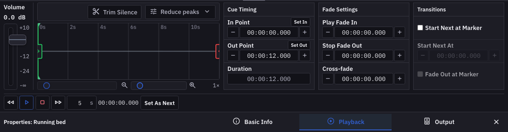

**Procedure — trim and rehearse one cue**

- **Prerequisites:** Use a rehearsal copy, a safe listening level, and the same media file planned for performance.
- **Actions:** Open **Playback**, set In and Out, set the required fades, save the trim, then play from before the entrance through the exit. Repeat through any Start Next marker or cross-fade.
- **Expected visible outcome:** The playhead begins and ends at the authored region; any following cue starts only by the selected end/marker rule.
- **Common mistake:** Judging the waveform visually and skipping the last seconds of the audition.
- **Recovery:** Stop, widen the region, remove the automatic transition if its target is uncertain, and rehearse again.

| Control or concept | Use it for |
| --- | --- |
| In Point / Out Point | Choosing the playback region without treating a waveform view as a destructive audio editor. |
| Play Fade In | The cue's fade-in at the start of playback. |
| Stop Fade Out | The authored fade at the end of the cue's playback region; it also contributes to manual-stop timing. |
| Cross-fade | Starting the following cue before the current cue ends, for overlap. Rehearse with both cues' ducking and fades. |
| Start Next at Marker | Starting the next cue at a chosen waveform marker instead of relying on the ordinary end point. |
| Fade Out at Marker | Fading the current cue as the Start Next marker transition occurs. |

**Start Next at Marker** takes precedence over ordinary cross-fade timing. Loop suppresses automatic next, Start Next, and cross-fade until its live behavior is changed. Manual Stop uses the greater of Stop Fade Out and the cue's legacy fade-out duration, which is 1 second on a new cue even when the visible Stop Fade Out is 0. Fade Out at Marker uses that legacy duration. Stop All uses its separate global fade. Rehearse these paths separately rather than assuming a zero visible fade makes every stop instantaneous.

The waveform's action menu separates **Loudness (LUFS)** from **Reduce peaks (dBTP)**. LUFS normalization can raise or lower the cue's **Volume** toward a measured loudness target, up to the existing +10 dB cue-gain limit. **Reduce peaks** only lowers a cue whose resulting peak exceeds the chosen ceiling; safe, quiet or muted cues keep their level. Raising that ceiling never boosts the cue back up. The peak ceiling is bounded by the active limiter ceiling.

These actions write cue gain, not a rewritten media file. **Trim Silence** adjusts the cue region around digital silence with padding; quiet breaths, ambience and tails are retained rather than treated as a loudness target. Review the resulting Volume and In/Out values and rehearse the entrance and exit.

Stop All remains available during slow seek, trim, loop and cue-removal decoder work. After Stop All, arm a ready backup on a different cue and press GO. If the controller reconnects, wait for it to verify the show. An accepted edit stays saved, a queued seek retains the latest requested position, and canceled playback cannot restart or advance when storage returns.

### Choose the end behavior deliberately

In **Properties → Basic Info**, click the current **Start Behavior** or **End Behavior** to expand its choices in the lower panel. The playlist and **GO** remain available. **Escape** runs Stop All while the choices are open, even if you changed the Stop All shortcut.

<!-- diagram:cue-lifecycle -->

The group cue-lifecycle chart distinguishes Audio Start actions, descendant playback, natural completion with Audio End actions, and cancellation by manual stop. It is a decision aid, not a timing trace: a real decoder, network, fade, or device can still refuse or delay a transition.

| End Behavior | Result to rehearse |
| --- | --- |
| Nothing | End the cue without automatically starting a following item. Use for manually called, stop-and-wait cues. |
| Play Next | At audio end, start the resolved next target; this can honor the acknowledged **Up Next** target, otherwise it follows the structural next sibling in the same immediate container. Confirm the displayed target before playback reaches the end. |
| Go to Item | Start the specifically selected cue when this cue ends. |
| Go to Index | Start the item at the configured index; recheck after changing the hierarchy. |
| Loop | Repeat the cue's playback region until the operator changes the live course of playback. |

**Procedure — make a cue stop and wait**

- **Prerequisites:** Select the intended cue in Edit Mode and confirm no current playback depends on an automatic transition from it.
- **Actions:** Open **Properties → Basic Info**, set **End Behavior** to **Nothing**, save if Autosave is off, and rehearse the cue through its natural end.
- **Expected visible outcome:** **Nothing** remains selected and the cue ends without automatically starting another item; a later **Play Next** target may still be prepared for a deliberate GO.
- **Common mistake:** Reading **Up Next** as proof that the next cue will start automatically.
- **Recovery:** Stop unexpected playback safely, return the ending to **Nothing**, inspect Audio Start Behavior and marker actions for other automatic starts, and rehearse again.

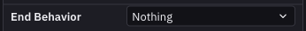

Do not use a loop as a substitute for rehearsing the loop boundary. Check for clicks, a level change, or a gap at the join on the actual output hardware. See chapter 7 for **Cue to Continue**, which releases the current pass without rewriting the saved Loop setting.

**Audio Start Behavior** is authored separately from End Behavior. Its Play Next, Play Item, and Play Index choices run when that cue starts; **Start Next at Marker** remains a separate timed playback action. These starts can create overlapping or structural playback, so rehearse the target, ducking, loop, and cycle-fence behavior rather than assuming the cue only affects what happens at its end.

### Groups

Open the group's **Edit** control to see **Start Behavior**, **End Behavior**, and the **Continue with** backup selector together under **Cueing**. **Play First** follows the first-child path and honors each nested group’s Start Behavior. It requires the first child to be ready. A nested **Play All** on that path can start several cues. **Play All** owns the selected descendant subtree and starts each selected playable descendant exactly once, including nested groups. For **Play All**, set each child's ducking for simultaneous playback.

Set **Group Level** in Properties to lower all audio inside the group, including the soundtrack of video cues. The fader runs from −60 to 0 dB and applies on release. Individual cue gains stay as saved. A cue inside several groups receives the combined attenuation, and cues outside the group keep their own levels.

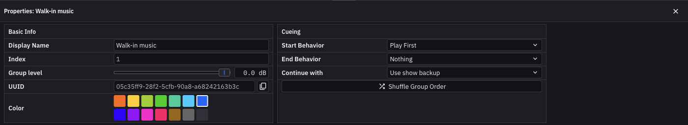

**Procedure — validate a group before it reaches the run sheet**

- **Prerequisites:** All intended descendants are imported, named, and individually playable.
- **Actions:** Select the group, set **Start Behavior**, inspect every selected child's ducking and ending, and set the group's own End Behavior. Arm the group and fire it once in rehearsal.
- **Expected visible outcome:** **Play First** follows the first-child path, including any nested Play All; **Play All** starts the complete selected subtree only after preflight succeeds. The group ending runs once after normal completion.
- **Common mistake:** Giving children **Stop All Other Cues** inside a Play All group.
- **Recovery:** Stop the run, correct child ducking, return the group ending to **Nothing** until its exit is certain, and repeat the complete rehearsal.

A group's GO is acknowledged only after the engine has preflighted the actual selected subtree. If any required descendant cannot start, the group is refused without partially starting its other children and stays armed for retry. Once accepted, the group owns that run through nested transitions, manual stops, and cancellation; verify the expected active descendants after GO.

A child's **Play Next** advances within its immediate group. When an owned group run completes, the group's configured End Behavior is applied exactly once. Use the group ending or an explicit Go to Item/Index target to leave the group, and rehearse nested groups so only the intended transition crosses the boundary.

Manual stop or cancellation ends the owned group run without allowing stale child completions to fire its ending later. **Nothing** remains the safe default when the group must stop and wait.

### Shuffle a playlist or group

In Edit Mode, choose the shuffle icon on a group row or **Shuffle Group Order** in Group Properties. During playback this shuffles the upcoming children and keeps the current and earlier children and any prepared handoff in place. Nested groups move together. Cues addressed by saved numbered actions stay in place, and an explicit **Up Next** stays on the chosen cue. With playback stopped, **Shuffle Playlist** in the toolbar reorders the top-level cues and groups. External controllers that send cue numbers follow the new order. Save the show to keep the order when Autosave is off.

### Beds, stings, and ducking

The **Ducking** choices are **Stop All Other Cues**, **No Ducking**, and **Duck Others**, with a **Duck Level**. Decide what a cue should do to sound that is already running before you fire it.

<!-- diagram:duck-envelope -->

The duck-envelope chart is **schematic, not measured**. It shows authored attack, the strongest active absolute ceiling during overlapping duck owners, and authored release toward recomputed base gain. It does not predict loudness, console dynamics, or the exact curve on any hardware.

- For a sting that must leave a music bed running unchanged, choose **No Ducking** and rehearse both levels together.
- **Duck Others** temporarily sets each other active cue's gain to the absolute Duck Level, then restores its prior gain. It is not a relative reduction: a cue already quieter than that target can become louder. Choose and rehearse the target against every cue that may be running, including the restoration when ducking ends.
- **Stop All Other Cues** is intentionally disruptive. It is appropriate when replacing existing playback, not when adding a layer that must coexist.

## 6. Audio outputs, Preview, levels, and timecode

### Establish the main output

Open **Settings** and choose **Audio Device** for the show. Check the device name in the main output strip and listen at the sound system. Hardware names and availability can change when a device is unplugged, a driver changes, or the show moves to another computer.

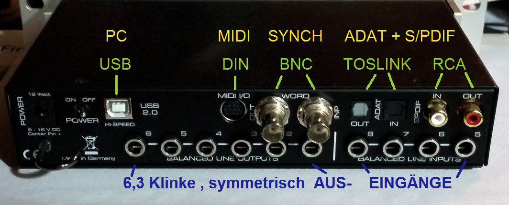

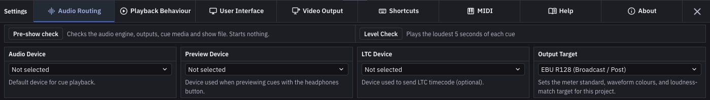

**Procedure — prove the Main route end to end**

- **Prerequisites:** The console operator is present, audience feeds are protected, cables are labelled, and a known low-level test cue is available.
- **Actions:** Open **Settings → Audio Routing**, select **Audio Device**, save, and confirm the same device in the workspace output strip. Play the known cue at a conservative level while the console operator identifies the arriving channel and destination.
- **Expected visible outcome:** Transport and the intended output meter move, and the console operator confirms the expected physical input and listening destination.
- **Common mistake:** Stopping after seeing an application meter.
- **Recovery:** Stop audio. Trace cue override, project device, application output, interface channel, cable, console patch, mute, and destination in that order.

A cue may specify a different **Properties → Output → Output device**. Verify overrides when preparing the backup machine. The previous selection stays in place until the engine accepts the change. Use **Stop All** to cancel an edit waiting for a device to open.

Media can show as ready while the engine prepares its audio outputs. If a driver stalls during that preparation, you can still use **Stop All**, close or open a show, and import healthy media. Play a test cue through each required Program and LTC destination before doors.

If GO waits while opening a named Program output or **System Default**, use **Stop All**. When the controller has verified the show again, arm a prepared backup cue on an available output and press GO. The canceled cue stays stopped when the driver returns. If the output fails to open, the warning names the device and the armed cue remains available for a deliberate retry.

The engine supports more advanced routing through its API, but the current desktop app does not mount a routing-matrix editor. The current operator-visible routing detail is the project device selection and a cue's **Properties → Output** override.

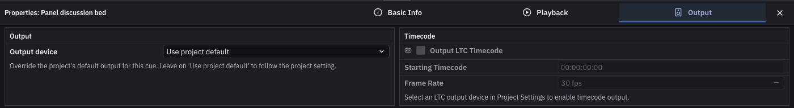

### Configure Preview before using headphones

1. Connect and identify the intended headphone or monitor device.
2. Open **Settings → Preview Device** and select it.
3. At a safe level, use a cue's **Preview** control and verify that it is heard only where intended.
4. Stop the preview before returning to show operation.

If Preview is not configured, its cue-row control opens Project Settings. Preview is separate from Program and Video Output. A slow Preview load does not hold Program GO or Stop All. Stop Preview, Stop All or changing the Preview device cancels the pending audition; storage recovery does not start it later. Preview indicators retain the current audition when an older request finishes late. Sharing Main's physical output still makes both signals audible there.

> **CAUTION — No automatic audience isolation.** The word Preview does not make the output private. Use an actually separate device/output and test it with the console operator. Do not audition an unknown cue through Main during a performance.

### Respond to an audio-output warning

A missing or stalled audio callback shows a red header warning even while cue controls remain available. Confirm the intended interface and cable, then use the header's **Reconnect audio output** button. The button remains available after the warning text expires. Reconnecting restarts the device stream in place and retains its routes and cue identities. Wait for the recovery indicator to clear after callbacks return, then verify the physical destination before another GO. Explicit Stop and current recovery choices still take precedence over pending playback recovery.

Secondary devices follow the master clock using continuous correction. Their queue absorbs callback bursts and adds around 11 ms of buffering at 48 kHz compared with the previous software. The master queue stays at three blocks. Check recurring buffer warnings and align independently clocked outputs through the actual line-level destinations during rehearsal.

### Gain, metering, and the limiter

<!-- diagram:gain-stages -->

The gain-stages chart separates cue gain, ducking, engine/MIDI internal global gain, output faders/trims, and the final device stage. That final stage sums all logical routes sharing each physical channel, adapts secondary device clocks, then applies the true-peak limiter. The Preview route joins its selected device and shares the same final-channel protection when it uses Main’s hardware. **Preview is also affected by the internal global-gain stage.** That internal stage has no separate UI control or readout; the visible main **Master** fader remains an output control. The chart is a logical map, not a calibrated measurement of the interface, console, amplifier, or room; limiter behavior is described below.

Balance cues at their own level controls first, then use the main output level for the overall show. Leave practical headroom for overlapping cues. A large positive gain setting can make a quiet source unexpectedly loud; changing the output target is not a replacement for a listening check.

The selected output target influences meter presentation, loudness targets, and limiter ceiling. The Live target uses a true-peak ceiling of approximately **−0.1 dBTP** by default. The **TP Limiter** control shows gain reduction; the ceiling can be adjusted. Keep the limiter enabled unless you have a specific, rehearsed reason not to.

The limiter is a maximum, not a measurement target. Signals below its ceiling keep their gain. It only attenuates overs, with continuous lookahead through a ceiling change or an explicit bypass. It does not normalize the show or lift a quiet cue. When Main and Preview share a physical channel, their combined signal receives the final protection; the mapped meters and gain-reduction display report that physical sum.

A limiter reduces digital peaks; it does not protect against an inappropriate acoustic level, a badly balanced cue, a wrong output patch, or downstream console gain. Persistent large gain reduction is a reason to lower and rebalance the source, not to raise the ceiling until the warning disappears. Use **Level Check** during preparation and resolve problems before switching to Show Mode.

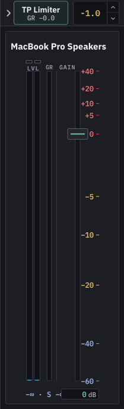

**Procedure — set a repeatable operating level**

- **Prerequisites:** Main routing is proved end to end and the console gain structure is agreed.
- **Actions:** Return individual cue gains to reviewed values, set the visible main **Master** output fader to the agreed reference, and set other output faders only when their routes require it. Play representative single and overlapping passages while watching meters and limiter reduction and listening at the destination.
- **Expected visible outcome:** The main Master output fader changes that output pair while the other output faders retain their own values; peaks retain headroom without sustained limiter reduction.
- **Common mistake:** Assuming MIDI Master Volume will move the visible output fader, or using the main fader to hide one badly balanced cue.
- **Recovery:** Stop or lower safely, restore the documented output-fader references, rebalance the cue itself, and repeat single plus overlap checks.

### Output LTC timecode

LTC is an audio-encoded synchronization signal for other equipment. It can be loud and unpleasant if routed to audience speakers. Set **Settings → LTC Device**, then enable **Properties → Output → Output LTC Timecode** only on cues that require it. Select the frame rate and start timecode to match the receiving system.

The engine supports 24, 25, 29.97 non-drop, 29.97 drop-frame, and 30 frames per second. The receiving device must use the same convention; drop-frame and non-drop are not interchangeable labels. Confirm lock and the starting timecode with the receiving operator during rehearsal, including what happens on stop, seek, replay, and a loop.

An LTC edit takes effect immediately when the output is ready. If the driver needs to open the output, the edit stays in the show while the engine opens it in the background. If startup stalls during an edit or cue start, use **Stop All**, then **GO** on a ready backup that uses a working output. The edited cue keeps its timecode settings for a deliberate retry. If the output fails to open, the app names the device and Program audio can still start.

Keep the LTC destination separate from the audience audio path. Do not enable timecode on a cue merely because the checkbox is available. Record the device assignment and frame rate on the show handover sheet.

## 7. Run the show

### A repeatable GO procedure

1. Confirm the correct show and a connected, ready engine.
2. Read the caller's cue and find the intended item.
3. Read the name beside **Play Next** and check **Up Next** in the list. Use **Locate Up Next** if the row is out of view. Use **Set As Next** if you need to override the automatic candidate; do not toggle an already correct manual target off.
4. On the cue call, press **Play Next** or its assigned shortcut once.
5. Confirm the expected active cue and progress, then prepare the next target.

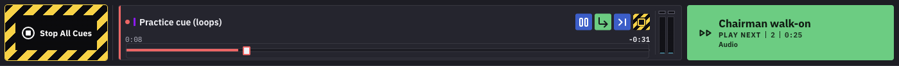

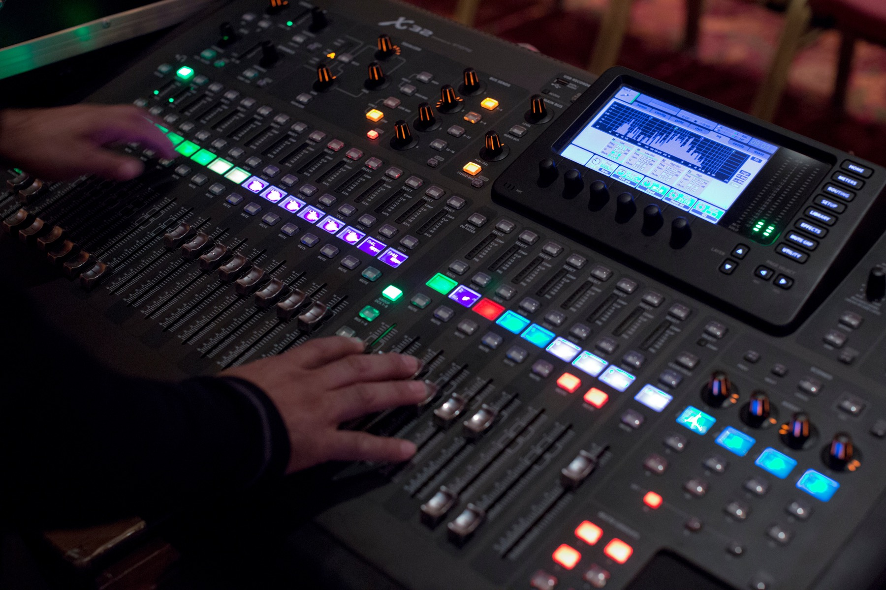

**Procedure — call and confirm one GO**

- **Prerequisites:** Correct show, engine, output, stop policy, and next target have been checked; hands are clear of unrelated controls.
- **Actions:** Read the cue call, read the name beside **Play Next**, press GO once, and move your eyes to the active-cue area. Confirm the intended name and advancing time before preparing the following target.
- **Expected visible outcome:** The accepted cue becomes active and the next acknowledged target is displayed separately.
- **Common mistake:** Double-pressing because the first request takes time to acknowledge.
- **Recovery:** Do not press again blindly. Read active state and any refusal; use the rehearsed Stop All/console response if wrong material is active, otherwise resolve the refusal and make one deliberate retry.

The default GO key is **Space**. **Enter** sets the selected playlist cue as **Up Next**. While the engine is confirming the new target, GO is unavailable. Press Space after the target name appears and **Play Next** is available. Check the project's shortcut assignments before operating. An unready start is refused visibly, the armed target is retained, and Stop All/Panic remain live. Resolve the reported cause, then retry once.

### Keep walk-in music going

1. Create a **Play First** group with an audio-only music bed and the intended venue output. Use **Loop** on the bed if it should play until the next GO.
2. In **Settings → Playback Behaviour**, choose it as the **Backup music group**. For an individual group, use **Continue with** in its Basic Info to choose a different destination.
3. Turn on the music-note button beside **Playlist** for top-level cues or on the group row for that group. Green shows it is on. The button is available in both modes after a backup is configured.

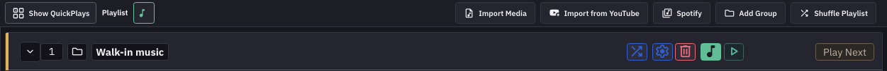

At a **Play Next** ending, the acknowledged **Up Next** cue has priority when its media and output are ready. Without an explicit choice, the normal next cue has priority. If neither can start and Program would be silent, the app tries the prepared backup and shows the result in the header. A missed target can remain armed for a deliberate GO after the cause is corrected. **Nothing**, manual Stop, and **Stop All** still stop. Use **Play First** groups for this automatic handoff. Launch a **Play All** group with GO.

Rehearse the last track, a late **Up Next** change, and **Stop All**. Both the chosen cue and backup can be unavailable. A backup starts when the engine detects the ending, so a brief gap is possible.

### Active-cue controls

Pause/Resume holds or resumes an active cue. Stop uses its configured stop behavior; a row’s Restart starts a fresh playback instance and cancels a pending one-pass action. **Stop All Cues** affects every active cue. Its default fade is 1 second; set and rehearse 0 seconds if immediate silence is required.

### Finish a loop without changing the saved show

Use **Cue to Continue** to finish the active loop pass and advance. It resolves the saved item/index destination or next sibling. You can still set a different **Up Next** before the pass ends. With no valid target, the pass ends without another cue. The saved End Behavior stays Loop.

If Cue to Continue stalls, use **Stop All**. The controller reconnects if the command is still awaiting acknowledgment. After it verifies the show, arm a ready backup and press GO. The canceled command cannot change a later playback of the loop.

Stop, replay, removal, media replacement, Stop All or project switch cancels that one-pass continuation. A later replay uses the authored ending. **Toggle Loop** instead edits the project’s End Behavior between Loop and Nothing; it does not restore a prior ending. Autosave saves this edit; otherwise it remains dirty. Choose Cue to Continue for a one-pass release.

**Jump Cue** stops the current cue and advances immediately. Rehearse its target and audible transition. **J** defaults to Jump Cue and **C** to Cue to Continue.

### When the expected cue does not start

A failed GO retains its armed target. Resolve missing/unready media, decoder errors, connection problems or an unavailable target before one deliberate retry. Selection and Set As Next change that target only after acknowledgment. A refused Play All preflight starts none of its selected subtree; inspect every selected child’s readiness. A failed automatic child or nested-group follow also holds enclosing group endings: correct the target, confirm Up Next, then press GO deliberately.

For overlapping playback, check Ducking. If the wrong material is audible, use the rehearsed stop or console-mute procedure before investigating.

### Header warnings

Header warnings temporarily replace the show name. The steady **Silence in** countdown stays in that slot when another warning appears beside it. The show name returns when the warnings clear. Red urgent warnings take priority over yellow advisories. Audio and video recovery buttons stay available while their outputs need attention.

In **Settings → User Interface**, set the four durations and two countdown thresholds for this device. Defaults are **5 seconds** without a countdown, **3 seconds** above 30 seconds remaining, **2 seconds** from 15 through 30 seconds, and **1 second** below 15 seconds. A timing change applies to the next message.

Open a swatch in **Settings → User Interface → Time Left colors** or **Settings → Video Output → Test card**. Choose a preset, or enter a hex color and press **Enter** or **Apply color**. Time Left ranges save with the show, and Test Card colors are stored on this machine. The playlist and **GO** stay available. **Escape** runs Stop All even when remapped.

### At the interval and at the end

Stop or intentionally leave only the required interval material running. Verify the next target for the restart and avoid editing device assignments while audio is live. After the final cue, confirm that all active cues and previews have stopped. Save any intended changes, make the required backup, and choose the appropriate client/server quit action in chapter 11.

## 8. QuickPlays, keyboard control, and MIDI

### Prepare independent quick-play cues

In Edit Mode, click **+** in an empty **QuickPlays** slot. In the lower panel, select one audio or video file on the engine computer and click **Import selected**. Use **File handling** to copy or link the file. **Cancel** leaves the slot as it was. The playlist, GO, and Stop All stay available. **Escape** stops playback and leaves the picker open, even with a remapped Stop All shortcut.

Drop a file from the controller directly onto a slot, including for a remote engine. To make an independent copy of a playlist cue, drag it to a slot or use **Add to QuickPlays** in Basic Info.

The tile gear opens **QuickPlay Settings** below the playlist or detached tiles in both modes. In Edit Mode, **Replace audio** uses the same file browser and the remove control is available.

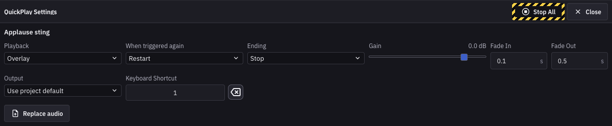

| Setting | Operator decision |
| --- | --- |
| Playback: Overlay | Mix with the program without ducking it. |
| Playback: Duck Program | Temporarily set other active cues to the absolute Program Level, then restore their prior gains. A quieter cue can be raised; rehearse the actual result. |
| Playback: Replace Program | Stop the other program cues when firing this QuickPlay. |
| When triggered again: Restart | A later accepted trigger starts the QuickPlay again. |
| When triggered again: Ignore | Ignore further triggers while it is already active. |
| Ending: Stop / Loop | Finish once or repeat; prepare a stop plan for every loop. |
| Output | Use the project default or a deliberately selected separate device. |

New QuickPlays start with **Replace Program**, a **0.1-second fade-in**, a **0.5-second fade-out**, Ending Stop, and retrigger Restart. Saved cues retain their playback and fade settings. When you choose Duck Program, **Duck Time** and **Release Time** set the attack and recovery. Overlapping duck owners use the strongest absolute Program Level, and restoration follows the surviving owners before returning each cue to its recomputed base gain. Rehearse the actual envelope and the case where one overlapping QuickPlay ends before another.

### Fire and stop

In either mode, press the tile's **Play** button, its shortcut, or its MIDI control to fire directly. The button changes to **Stop** when playback is active. Use the number row for slots **1–10** and hold **Shift** for slots **11–20**.

To return from a playing QuickPlay to the playlist, set the playlist cue **Up Next** and choose **Cue to Continue** on the active QuickPlay. The default **C** shortcut does this for the active transport target. The QuickPlay finishes its current pass and plays whichever playlist cue is **Up Next** at that point. Use **Stop All** to cancel the handoff. The saved ending stays in the show file for the next play.

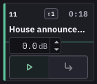

**Procedure — rehearse a QuickPlay**

- **Prerequisites:** Its audio, output, Overlay/Duck/Replace policy, retrigger, ending, and stop plan were rehearsed.
- **Actions:** Trigger the named QuickPlay with the intended control and verify its interaction with any active program cue.
- **Expected visible outcome:** The named QuickPlay plays and its button changes to **Stop**.
- **Common mistake:** Assuming a hidden bank disables its number keys.
- **Recovery:** Use the tile's **Stop** or **Stop All Cues**, then correct the settings in Edit Mode.

Press **Q** to show or hide the docked bank. Press **Shift+Q** to open or close the detached QuickPlays window. **Shift+Q** also closes it when the detached window has focus. The **Detach** and **Attach** buttons offer the same window controls by mouse. Rehearse focus and screen placement on the actual machine. Check active playback before assuming a hidden or removed tile has stopped.

### Assign and verify keyboard shortcuts

Open **Settings → Shortcuts**, select a binding, and press the desired key. For a MIDI controller, open **Settings → MIDI** and use **Learn** beside the action. Use the **×** button beside a binding to clear it. Resolve any reserved combinations or conflicts before rehearsal. **Show shortcuts bar** toggles the one-line reference for transport and the two **QuickPlays (defaults)** key ranges. **Customize Shortcuts…** opens the full list. The arrow beside a number on a tile means Shift. Individual tile settings also provide **Keyboard Shortcut**, **Assign shortcut**, and **Clear shortcut**.

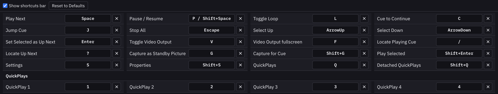

**Procedure — hand over a keyboard-controlled show**

- **Prerequisites:** Audio is stopped or protected and the outgoing operator can identify all non-default assignments.
- **Actions:** Open **Settings → Shortcuts** and compare GO, Set Selected as Up Next, Stop All, Pause/Resume, loop actions, and QuickPlay keys with the handover sheet. Focus the workspace and test during rehearsal.
- **Expected visible outcome:** Each tested key invokes exactly the labelled action once.
- **Common mistake:** Testing Space or Escape while a text field or Video Output has focus and generalizing from that result.
- **Recovery:** Stop safely, close editors, restore workspace focus, check conflicts, and repeat the controlled test.

Keyboard assignments belong to the project. QuickPlay slots **1 through 9** default to their matching number keys, and **0** fires slot **10**. **Shift+1** fires slot **11**, **Shift+2** fires slot **12**, and so on through **Shift+0** for slot **20**. Saved assignments take precedence. **Clear shortcut** disables a tile's key. **Reset to Defaults** in **Settings → Shortcuts** restores the defaults. Use **Enter** to set the selected cue as Up Next, **Space** to fire it, **Shift+Enter** to play the selected cue immediately, and **L** to toggle Loop. **P** and **Shift+Space** both pause or resume. **C** cues a loop or QuickPlay to continue at the end of its pass. **J** jumps to the next cue. **F1** also plays the selected audio cue.

The main workspace accepts playback and QuickPlay shortcuts with the bank visible, hidden, or detached. The mapped **Stop All** works even while the shortcut editor is learning a keyboard or MIDI assignment.

In the playlist workspace, Enter, Space, and Escape keep their assigned show actions after Tab moves focus to a button. Text fields own typing while you edit. Keyboard/MIDI Pause/Resume and Toggle Loop target the first active cue, otherwise the selected audio cue. Use the cue's visible control if several cues are active and you need to target a specific one.

**Cmd/Ctrl+C** copies highlighted text when you select it, including About credits. To copy a cue, select its playlist row and press **Cmd/Ctrl+C** in the workspace.

> **SAFETY — Pause/Resume can start audio.** With no active cue, keyboard or MIDI Pause/Resume starts the selected audio cue if it is inactive. It is not a universal silence command. Mapped Toggle Loop also edits authored project behavior, subject to Autosave/Save; use Cue to Continue for a runtime-only loop release.

### Map a MIDI controller

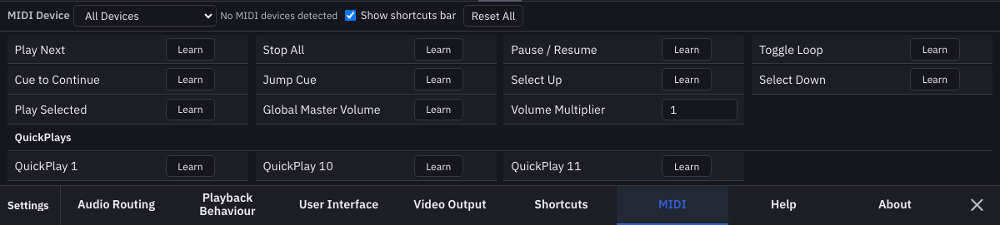

1. Connect the controller before the show and open **Settings → MIDI**.
2. Select the intended **MIDI Device**. **All Devices** listens broadly; choosing a particular controller reduces accidental input from other connected equipment.
3. Choose **Learn** beside the required action and operate the intended pad, button, or fader once.
4. Check the captured channel and message, resolve any **Reassign** conflict, and leave Learn mode.
5. In a safe rehearsal, test exactly one intended action, including arming and retrigger policy for QuickPlays.
6. Repeat on the backup computer. MIDI mappings are machine settings, not part of the project document.

There are no default MIDI mappings. Supported inputs include Note, CC, and Pitchbend. A Note On must have nonzero velocity; discrete CC/Pitchbend activation uses values above the midpoint. Note Off does not stop a cue. Do not assume a held pad means “play while held.”

**Master Volume uses directional steps, not an absolute fader position.** The first received MIDI value establishes a reference; subsequent movement nudges the engine's separate Master Volume state up or down by the configured multiplier. It does not move the visible main Master output fader or the other output faders. Use a conservative multiplier and verify the result through the rehearsed meter/listening path. Controls are ignored while disconnected, although Learn can still capture a mapping. This is application routing behavior, not a claim that physical MIDI hardware was certified by this source review.

### External triggering

Cue Basic Info displays **API Trigger URL · POST** with a copy control. An external controller must send the indicated method and authenticate; simply opening the URL in a browser is not equivalent. Have the system administrator configure and test the integration before the show. This source supports authenticated HTTP/WebSocket control, not a built-in OSC listener. Do not create an OSC show plan based on a future-feature description.

## 9. Video Output

### Choose the picture computer and display

Video Output belongs to the desktop client, not to the headless engine. The recommended arrangement keeps the audio engine and video-rendering desktop on the same machine. If you use a remote engine, the picture still appears on the desktop client's display/HDMI and the media is streamed over the network; include that network in rehearsal and failure planning.

Use **V** or the toolbar's **Video Output** button to open or close the output window. Assign the intended display under **Settings → Video Output** and verify its identity against the physical projector, switcher, or monitor. The app remembers the display assignment on that computer, and the output window starts closed on each application launch. Open and check it for each session.

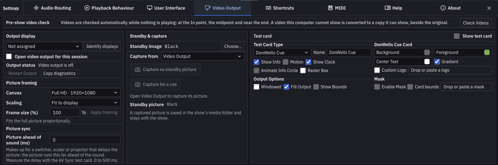

**Procedure — open and identify the audience output**

- **Prerequisites:** Operator and audience displays are extended rather than mirrored, the switcher/projector operator is ready, and no private desktop content is exposed.
- **Actions:** Open **Settings → Video Output**, choose **Identify displays**, match the number at the physical destination, select that **Output display**, and enable **Open video output for this session**. Read **Output status**.
- **Expected visible outcome:** The numbered labels clear after five seconds. Settings stays available while they are shown. After you enable output, it reports live on the intended display and the destination operator confirms the same image.
- **Common mistake:** Treating the single-display preview window as the assigned fullscreen output.
- **Recovery:** Disable the session output, correct mirroring/cabling/assignment, identify again, then reopen and verify at the physical destination.

With only one display or no dedicated assignment, the app uses a normal preview window rather than automatically taking over the control screen fullscreen. Do not mistake a preview window for a correctly assigned projector output. Use an extended desktop, not operating-system display mirroring, when you need separate operator and audience surfaces.

**Procedure — line up picture and optional AV Sync**

- **Prerequisites:** The audience feed is safe to show a test pattern and, for AV Sync, the selected DonWells Cue Program output may safely carry the native tone.
- **Actions:** Open **Settings → Video Output**, choose **Show test card**, then click the current **Test Card Type** to pick a pattern in the lower panel. Confirm identity, resolution, and framing at the destination. For **AV Sync**, select the intended Audio Device, run the tone with audio staff ready, then switch the card off.
- **Expected visible outcome:** The physical destination shows the labelled card within the expected bounds; AV Sync is visible and audible only through the intended Program path.
- **Common mistake:** Assuming AV Sync is silent or routed to Preview.
- **Recovery:** Press **Stop All** to stop the tone, switch the card off and on only when a restart is intended, then correct the selected Audio Device before retesting.

The playlist and **GO** remain available while the card choices are open. **Escape** runs Stop All even if you changed the Stop All shortcut. **Stop All** also cancels a pending AV Sync device start. The test stays off when the driver returns.

In **Settings → Video Output → Test card**, drop or paste a PNG, JPEG, WebP, or GIF onto the logo or mask field. Both show a preview and offer **Clear**. **Custom Logo** shows the logo. A new mask enables itself. A rejected file leaves the previous image in place. The playlist and **GO** stay available during loading. **Escape** runs Stop All even when remapped.

### What the audience sees

The output shows one picture at a time and cuts to the newest sounding cue. **Full HD**, **Fit to display**, and **100%** are the default picture settings. A 16:9 cue fills a 1920 × 1080 output edge to edge. Video and stills retain their proportions and show the entire source. Black fills any space around the picture.

When a cue has no usable video, the output uses the first available layer in this order. Assigned **Cue image**, captured cue still, captured session standby, saved **Standby image**, then black. The native audio engine drives the soundtrack. Preview/headphone playback stays off the audience output. A video can play on Video Output while the operator auditions that same cue in Preview.

Choose an image in **Properties → Basic Info → Cue image** or **Settings → Video Output → Standby image**. Browse in the lower panel, select the file, and click **Open** to copy it to the show's media folder. **Cancel** returns to the previous panel. Selecting another cue closes an unconfirmed cue image picker. The playlist, GO, and Stop All are available while browsing. **Escape** runs Stop All and leaves the picker open.

At an automatic **Play Next** ending, Video Output holds the outgoing video's last frame until the next video has a picture ready. An audio-only cue uses its still or the standby layer. **Stop All** clears the held frame, and a decode failure uses the normal cue image or standby. If the last frame stays frozen, check the output status before pressing GO again. Rehearse through the full ending of each video.

Use H.264 or HEVC media for this source edition. ProRes and other production codecs are not supported by the documented video path. Container extension alone is not a codec guarantee. Test every video on the exact show machine, including its soundtrack, opening frame, end behavior, aspect ratio, and transitions between audio-only and video cues.

> **CAUTION — A fallback can hide a video failure.** If video cannot load or decode, the output can fall through to a cue image, standby image, or black without a blocking show alert. A healthy audio cue does not prove the picture is playing. Watch the actual destination during rehearsal.

### Check videos before the show

1. With playback and Preview stopped, open **Settings → Video Output** and choose **Check Videos**. The check silently loads a picture at each video cue's **In** point. It includes cues inside groups and video QuickPlays. Video Output can stay closed.
2. Read the count and cue names in the dock. Cues that need attention are marked **VIDEO !** on the playlist or QuickPlay tile. For a missing or unreadable clip, check the media location and replace or restore the file. For a decode failure, verify the source or use a compatible copy, then run **Check Videos** again.
3. Use **Cancel Check** to end the scan. Playback, Stop All, or leaving the panel also ends it. If a clip times out, the scan flags it and ends the run. The status shows how many cues were checked.

The check is advisory and keeps the playlist and transport available. Run it again after editing a video cue or replacing its file. A pass covers the picture at the In point. Rehearse the entire clip, its soundtrack, and the physical display chain on the show machine.

### Set picture framing

In **Settings → Video Output → Picture framing**, choose a **Canvas**, **Scaling**, and **Frame size**, then select **Apply framing**. Changes take effect in the open Video Output window. The choices are saved on this machine.

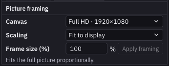

| Canvas | Dimensions | Shape |
| --- | --- | --- |
| Full HD (default), HD, UHD | 1920 × 1080, 1280 × 720, 3840 × 2160 | 16:9 |
| WUXGA, WXGA | 1920 × 1200, 1280 × 800 | 16:10 |
| XGA | 1024 × 768 | 4:3 |
| DCI 4K | 4096 × 2160 | 256:135 |
| Wide stage | 3840 × 1080 | 32:9 |
| Portrait signage | 1080 × 1920 | 9:16 |
| Custom dimensions | 64–16384 px for each side | Width divided by height |

**Fit to display** makes the canvas as large as the window allows. **Cap at canvas size** limits the canvas to the selected dimensions in display pixels and shrinks it to fit a smaller window. **Frame size** scales the result from 25% to 100% around the center. Use custom dimensions for the active raster supplied by the LED or signage technician. Both scaling modes preserve media proportions.

Set the HDMI resolution, refresh rate, and display rotation in the operating system. Confirm the received signal at the switcher or display. For a standard projector or TV, rehearse at Full HD with Fit to display at 100%. Check that the corner markers and edges of a framing pattern are visible and its circle is round.

### Capture a standby still

- Press **G** or choose **Capture output** in **Settings → Video Output** to save the current picture from the configured canvas. Bars outside that canvas are excluded.
- Choose a **Capture display** in **Settings → Video Output**, then press **Shift+G** or choose **Capture display** to save the selected screen. The capture display can be different from the audience display. Grant screen capture permission if the operating system asks.
- Set **Destination** to **Session standby** for a shared fallback or **Selected cue** for a specific cue. To capture Video Output for a specific cue in one step, select it and click the confidence thumbnail in the header.
- Capture again to replace the still at that destination. **Clear still** removes the capture for the chosen destination. Assigned cue images always take priority. Use a saved Cue image or Standby image for artwork that must survive closing or reloading the show.

### Recover a frozen or failed video output

Use **Settings → Video Output** to read output status. Renderer crashes and hangs latch a native black cover over the existing audience window while the operator controls remain available. Choose **Restart Output** in the header or in Video Output settings. The cover stays until the replacement view is ready. The replacement follows the current native cue state. Check the active cue before another GO. **Copy diagnostics** captures current output information for investigation.

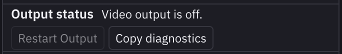

Keep the audience output open during this recovery. Closing the output window removes that surface and can expose the desktop. A lost display connection, a system/GPU failure or a downstream switcher fault may require the venue's separate standby/black source. Restart Output does not repair the physical chain.

The confidence display uses presented-frame and native-audio-clock progress as well as thumbnail delivery. A fresh thumbnail by itself does not prove a moving decoded picture. Paused cues and authored still images are valid still states. Rehearse the transitions between audio, video and standby with the actual show media.

### Fullscreen, keyboard focus, and blackout

Double-click or use the output window's context controls to change fullscreen. If the assigned display disappears, the app closes that output instead of moving it onto the control display; it can reacquire the assignment when the display returns while the session remains enabled. Recheck the physical output after reconnecting a cable.

Eligible playback keys from the focused Video Output are forwarded to the controller. **Escape exits output fullscreen and, with the default shortcut mapping, also invokes Stop All.** If Stop All is remapped, Escape still exits fullscreen. Rehearse this distinction before giving the output window focus during a show.

There is no dedicated video-blackout button or shortcut in this source. **Stop All is not a separate picture-blackout command**: a configured standby image can remain visible after cues stop. If the show needs a guaranteed independent blackout, prepare and rehearse it on the video switcher/projector or another supported part of the venue system. Closing Video Output can expose the desktop and is not an audience-safe blackout procedure.

## 10. Connect to a remote audio server

### Prepare the server deliberately

Use remote mode only when the audio computer is separate. The operator needs its address, control port, access token, and authorized restart contact.

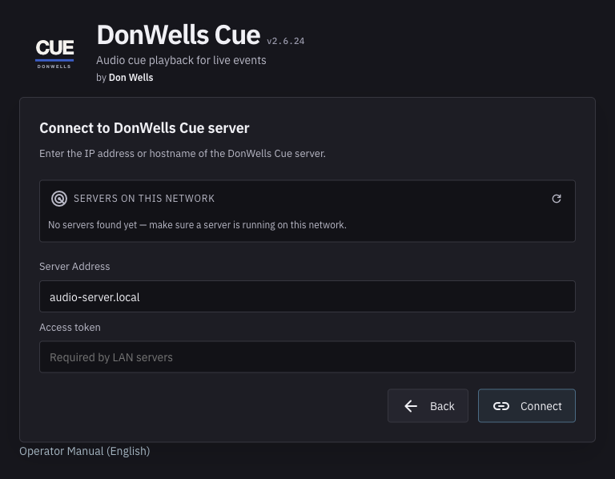

For a trusted-LAN setup, an administrator can start the installed standalone server with:

~~~text
dwcue-server --bind 0.0.0.0
~~~

Binding to 0.0.0.0 exposes control to network interfaces, unlike the local-only default. Every bind requires a token. An empty LIVEPLAY_ACCESS_TOKEN generates one once at startup; a supplied token needs at least 16 characters or startup fails. Keep it private.

| Default port | Purpose |
| --- | --- |
| TCP 4480 | Project/control requests, WebSocket transport/state, and media delivery. |
| UDP 4481 | Best-effort LAN discovery; a server can still be reached by address when discovery is unavailable. |

Allow only the intended trusted-network access. The app does not open firewall rules. Plain HTTP/WebSocket plus a bearer token is not safe for the public internet; do not forward these ports, and use an administrator-approved secure arrangement across untrusted networks.

### Connect the controller

1. On the welcome screen choose **Change**, then reveal **Connect to a server on the network…** if needed.
2. Choose **Remote**. Select a discovered server or enter the **Server Address** supplied by the administrator.
3. Enter its **Access token**, then choose **Connect**.
4. Confirm the server identity and project name. A server with a project already open can bring you into that existing session.
5. Check audio readiness and physical output before firing; a health probe does not prove authenticated control works.

**Expected result:** The workspace names the intended server project and accepts an authenticated, non-audible control check. **Common mistake:** entering `127.0.0.1` on the controller for a different audio computer. **Recovery:** return to Server Settings, use the audio computer's approved LAN address and current token, and reconnect without restarting an engine that another operator may be using.

Discovery may fail across subnets, VPNs, or restricted Wi-Fi; use the explicit address rather than treating an empty list as proof the engine is down. For a remote engine, localhost/127.0.0.1 points to the controller and is the wrong address.

### Credentials and shared control

The managed local desktop supplies its session credential automatically; do not copy it into a browser, show document, or authentication workaround. A managed restart refreshes it. External integrations need the current token too.

A browser integration's exact origin must be authorized; another localhost spelling or port is not implicitly trusted. Do not add a broad origin exception during a show.

A remote server is shared state. Another operator can close, replace, or edit its project, so agree who owns show control, changes, and restarts. Dirty local edits require the recovery choice described in chapter 11 rather than being silently replaced.

## 11. Save, back up, recover, and quit

### Know what is saved

<!-- diagram:save-recovery -->

The save-recovery chart separates an Autosave toggle's forced save from later off-mode edits, then shows the read-only hydration Retry path after an accepted native load. It is a decision map, not evidence that any disk write, backup, archive, or recovery request has succeeded.

**Autosave** is on by default. Changing the toggle in either direction force-saves the current document together with the preference. Do not use the toggle merely to experiment with an unsaved show. After Autosave is off, subsequent edits change the active engine document and remain dirty until an explicit save; after it is on, subsequent accepted edits request persistence. It is not an audio safety lock. Use **File → Save Project** for a deliberate durable checkpoint. New and converted shows save to their canonical `.dwcue` path.

When a command asks about unsaved changes, finish that decision first. If you choose **Save**, wait for it to finish. Run any declined command again after the first action completes.

A failed autosave or manual save leaves **Save failed** and **Retry** in the header. Correct the path, permissions, or storage fault, then choose **Retry**. Retry saves the current show even with Autosave off. The indicator clears once a save of the current changes succeeds. A detached QuickPlay save failure is also reported in the detached QuickPlays window and the settings panel.

**Procedure — recover from a save refusal without losing the show**

- Keep the current show open while checking that the destination volume is mounted, writable, and has free space.
- After correcting the fault, choose **Retry** in the header or use **File → Save Project**.
- Wait for the indicator to clear, verify the intended show file, and make a separate copy. Later edits follow the current Autosave preference.
- If saving still fails, preserve the running session and use a writable destination without overwriting a known-good show.

Saves run in order. Each captures one document and destination, then writes through a sibling temporary file before atomically replacing the saved show. Slow storage can delay a save or another save behind it. GO and Stop All remain available while the write waits. A failed Save As leaves the active path unchanged. If another controller switches shows during a write, the old save cannot change the new show's path or clear its pending edits. Wait for a save to finish before opening the file you just saved.

The server makes background copies of the existing disk project every 10 minutes into a **backups** folder beside it, retaining at most 20. Those are project-file backups, not full media packages, and they cannot capture unsaved edits that never reached disk. Keep a separate known-good full-show copy as well.

### Export a portable show

1. Stop the rehearsal at a known point and save the intended project changes.
2. Use **File → Export Project…**. The lower panel shows the destination browser. Navigate to a folder and select **Save Here**.
3. To save to the controller when using a remote engine, choose **Download Here**. The panel starts in Downloads. Drop another folder into the panel to change the location. Leave **Filename** blank to use the show's name, or enter a name, then select **Save Here**. If that name already exists, choose another filename and retry.
4. Wait for **Archive saved to** before using the resulting **.dwcuepack**. Export saves the show before packaging. Resolve any save failure before retrying.
5. Import it into a separate rehearsal location and verify cues, media readiness, images, and playback with the original source paths unavailable.

> **CAUTION — Export packages the project folder.** Keep the show in a dedicated folder. Do not choose a folder containing credentials, unrelated documents, personal media, or application data and assume export will include only the files shown in the playlist. Externally linked media also needs a deliberate portability check.

Device assignments, physical patching, local MIDI mappings, and video display identity need checking on the destination machine. A successful archive extraction is not a substitute for that check.

The playlist, **GO**, and **Stop All Cues** stay available during browsing and transfers. **Escape** runs Stop All while the panel is open. Closing the lower panel leaves the job running. Reopen the same File menu action to see progress or the saved path.

### Import a show or archive and inspect repairs

Use **File → Import Project…** for a portable `.dwcuepack` containing exactly one root `.dwcue` show. DonWells Cue refuses upstream LivePlay `.liveplay` shows and `.lpa` archives. Previously converted `.dwcue` shows open through **File → Open Project**.

For an archive on the engine, select it in the lower panel and choose **Choose Archive**. For an archive on a remote controller, select **From This Computer** and drop one `.dwcuepack` into the panel. You can paste if the clipboard supplies an archive file. Choose an empty folder on the audio-engine computer and select **Extract Here**. The panel shows the extracted location when it finishes. Select **Open** when you are ready to switch shows.

Extraction refuses unsafe entries and destination collisions rather than silently overwriting an existing show. If import reports a collision, choose a clean destination; do not delete the working show just to force an import. Wait for import and audio readiness, then listen to representative cues and inspect the important transitions.

If the engine accepts a repaired document, the cue list loads and **Show opened with repairs** appears. Use **Review Repairs** to inspect the issues and check the cue count, groups, QuickPlays, and jump targets. **Save Repaired Show** writes the repaired document to disk. If saving fails, the repaired show remains usable in memory and the original file is preserved.

**File → Open Project** opens the picker in the lower panel. Select a `.dwcue` and choose **Open**. The playlist, GO, and **Stop All Cues** stay available while you browse and respond to any save prompt. Canceling the picker or selecting an unavailable or invalid file leaves the current show playing. The same applies if **Open Recent** cannot load its file. A successful load, including reopening the same file, clears the previous selection and armed override. The first playable cue is armed when the project’s automatic-cue option allows it. Confirm Play Next before GO.

If Open expires or another controller opens a different show while the first file is still being read, the late Open cannot take over. If the connection drops before the reply arrives, wait for the controller to verify which show the engine has active before pressing GO. Update older remote engines before using Open from this controller.

**File → Open Recent** and opening a `.dwcue` directly from the desktop use the same lower panel. While the show loads, the playlist stays visible and GO waits for the controller to finish opening the show. **Stop All Cues** and **Escape** stay available. When a file opens at launch, use **Stop All** in the panel until the workspace opens. Stop All uses the current show's fade and lets the Open request continue.

Recognized malformed cue, group and audio-settings values are refused before replacing the current show or overwriting its saved file. Keep the known-good copy and correct the rejected document separately. Supported legacy/default repairs still apply; a refusal does not promise that every damaged file can be repaired.

When a project path is accepted but the page/header load cannot finish, the app enters an explicit read-only load-error state rather than exposing a partly hydrated editable document. **Stop All Cues** and its configured Escape shortcut remain available. Choose **Retry** after correcting the connection or storage fault. After native acceptance, Retry fetches the engine's current project header and pages; it never silently reopens the old file path. If the initial open itself was never accepted, Retry can retry that originally requested path. Confirm the loaded show name and cue readiness before editing or pressing GO.

Use **Choose Another Show** to open the standard show picker from the load-error screen. Canceling the picker or selecting a file the engine refuses leaves the current show running and keeps **Retry** available for its cue list.

**Procedure — retry a failed project load safely**

- **Prerequisites:** Protect the audience first and establish whether the server accepted the open request.
- **Actions:** Do not edit the failed view. Use **Stop All Cues** or its configured Escape shortcut if the operating plan requires it. Correct the connection/storage cause, choose **Retry**, then read the returned show name and cue pages.
- **Expected visible outcome:** The app leaves the failed view only after a complete current header/page hydration.
- **Common mistake:** Assuming Retry always reopens the originally chosen file.
- **Recovery:** If native acceptance already occurred, treat the server's current header/pages as authoritative and verify identity before GO. If the original open was never accepted, Retry may request that original path again.

### Connection loss is not proof that sound stopped

The **Connection lost** panel opens below the playlist in the main window. The last verified playlist stays visible for reference while cue starts and edits wait. **Retry now** retries the same server. Its **Restart** action relaunches the client. The engine and Program can continue running. **Exit** closes the client. Before restart or exit, the desktop removes client-owned AV resources. If cleanup fails, the diagnostic remains visible and the client stays open so you can correct the cause and retry. Verify the destination and credential before retrying a failed connection.

After the managed engine restarts, **Server restarted** offers **Continue session** and **Start fresh** in the same lower panel.

**Stop All Cues** stays available while the recovery panel is open, including its configured keyboard and MIDI bindings. **Escape** also runs Stop All when a different shortcut is assigned. Stop All uses a separate HTTP request so the engine can receive it while the control socket is down or waiting on a cue. The engine applies the active show's Stop All fade. **The engine accepted Stop All** confirms receipt of the stop request. If Stop All is unconfirmed, check the output and use your independent console-silence procedure as needed.

After the control link returns, **Verifying show** keeps GO and other cue starts unavailable while the controller checks the active show and loads its full cue list. If verification fails, the previous playlist stays visible for reference. Choose **Retry now**. When the engine has no show open or local edits need a decision, use the recovery panel to choose what to load.

**Procedure — respond to connection loss during a show**

- **Prerequisites:** The team has an independent console-silence procedure and a named person authorized to restart the engine.
- **Actions:** Tell the caller/control team that controller state is unknown. Listen and check the physical destination without firing controls blindly. If the same endpoint remains correct, choose **Retry now** once. Use **Restart** only to relaunch the client; use Server Settings for a wrong endpoint. If **Server restarted** appears, establish project authority before choosing **Continue session** or **Start fresh**.
- **Expected visible outcome:** The controller shows the verified active show and cue list before enabling cue starts. If recovery needs a choice, the prompt stays open until you decide.
- **Common mistake:** Treating **Restart** as an engine stop, or choosing **Exit** to silence Program.
- **Recovery:** Control sound through the agreed independent path, coordinate with the server operator, then verify project identity, active cues, devices, arming, and save state before the next GO.

When a network controller loses contact, do not assume the audience has silence. The remote engine may still be playing. Use the venue's agreed communication and independent output-control procedure. Avoid restarting an engine that another operator is actively using.

### Choose client or engine restart

In the **Connection lost** panel, **Restart** relaunches the client and leaves the engine and Program running. To restart the managed local audio process, use **Server Settings -> Restart engine** in Local mode. Coordinate that interruption with the show team and verify the returned project, active cue, position and output before GO. A remote engine requires its own operator's recovery procedure.

The local controller can connect and use Stop All while the default audio output starts. A backup can start on a separate device while another device waits in Start. If the driver is still initializing or releasing a device, a new output can report that it is unavailable. Use a cue routed to a ready output or retry the armed cue when the selected output returns. Confirm Program sound during soundcheck. Save the show before restarting the engine. If driver cleanup stalls during an intentional stop, the engine attempts to exit after about 1.5 seconds. The app verifies the old engine has exited before launching another.

### Choose the correct recovery direction

<!-- diagram:recovery -->

| Prompt / choice | What you are authorizing |
| --- | --- |
| Server restarted → Continue session | Reload the previous project and restore available local in-memory edits. Restored unsaved edits remain dirty; this is not a disk save. |
| Server restarted → Start fresh | Immediately discard the client-held document and return to Welcome, without an unsaved-changes prompt. If edits matter, choose Continue session first, then save or export them before leaving the session. |
| Server project changed → Use server project | Adopt the server document and discard local unsaved edits. |
| Server project changed → Restore local project | Replace the server's active document with the local document. This affects the shared session and remains unsaved until you save it. |

A matching path does not prove that two documents have the same edits. The current source asks for a decision when local edits are dirty and a server project is present, including changes to the same path. A clean controller follows the server's authoritative project without needing this conflict decision.

Before **Restore local project**, coordinate with the operator controlling the server. Before **Use server project**, decide whether you need to preserve the local edits. Neither button is a merge tool. After either recovery path, verify cue readiness, output devices, arming, active playback, and the actual saved state before the next GO.

### Engine crash recovery is best-effort

A fatal engine crash can trigger an automatic restart after about 5 seconds. Its roughly 2-second recovery heartbeat records the project and at most one playing/fading-in cue with a position. It is not an exact reconstruction of a live mix: paused cues, multiple simultaneous cues, and runtime Cue to Continue are not preserved as a complete scene.

Expect a possible position rollback and recheck the result before taking control. Playback may resume from recovery state, so coordinate the console response instead of assuming a crashed engine will remain silent. Repeated failures eventually disable automatic restart after five consecutive crashes. Preserve logs and diagnose the fault rather than repeatedly relaunching during a show.

### Quit the intended part of the system

Quit and **Unsaved Changes** open in the lower panel. The playlist, GO, and **Stop All Cues** stay available in Edit and Show modes. **Escape** runs Stop All with the configured fade and leaves the panel open, even if you assigned Stop All another key. Use **Cancel** or **Return to Project** to dismiss the decision.

For unsaved edits, New, Open, and Close offer **Save**, **Don't Save**, or **Cancel**. A successful Save writes the current show before continuing. A failed save leaves the current show open. If you cancel the decision while creating a new show, the New Show form returns with the name and location you entered. Quit offers **Return to Project**, **Close and disregard changes**, or **Save project, then close**.

**Procedure — clear the unsaved-project quit guard**

- **Prerequisites:** Identify whether the current edits belong in the durable show and confirm that no second operator is making a competing save.
- **Actions:** Invoke Quit, read the show name, then choose **Return to Project**, **Close and disregard changes**, or **Save project, then close** according to the agreed disposition of the edits.
- **Expected visible outcome:** Return keeps the project open; disregard advances toward closing without saving those edits; a successful save writes them before the close sequence continues.
- **Common mistake:** Treating **Save project, then close** as successful before the save result is known.
- **Recovery:** If save fails, remain with the project and selection intact, correct the storage fault, verify a deliberate save, then request Quit again.

If the managed local engine is running, the next choice distinguishes **Close Client Only** from **Close Server**. **Close Client Only removes client-owned Preview/test-tone resources but leaves the Program mix and engine running. Close Server stops playback and disconnects every connected client.** If you make further unsaved edits while this choice is open, Quit asks what to do with them before closing. A failed AV cleanup retains the owned-resource diagnostic and refuses the terminal action. Closing a controller connected to a remote engine does not shut down that remote engine.

**Procedure — end an operating session**

- **Prerequisites:** The caller and every connected operator agree the show is finished; intended edits have a confirmed save; live cues, Preview, and test tone are identified.
- **Actions:** Stop Program when required, verify the physical outputs, invoke Quit, and read the presented choices. Choose **Close Client Only** only when the engine/Program must remain; choose **Close Server** only when stopping playback and disconnecting all clients is authorized.
- **Expected visible outcome:** The selected component closes only after client-owned AV cleanup succeeds.
- **Common mistake:** Using **Close Client Only** as an emergency silence command.
- **Recovery:** If cleanup fails, do not force past the retained diagnostic. Correct the owned Preview/test-tone resource, retry the intended action, and control Program through the explicit transport/console path.

At pack-down, explicitly stop live cues and previews, verify the physical outputs, save the intended changes, and select the appropriate shutdown action. Closing a window is not the same operation as stopping the show.

## 12. Troubleshooting at the operator position

For the corporate-show setup covered by this audit, final acceptance is the actual **line-level output** into the receiving console and **1920×1080 progressive video** through the intended HDMI or adapter-to-HDMI path. Use the interface's documented line-level reference and verify the negotiated display refresh, channel mapping, representative A/V synchronization and mixed-cue handoffs. Software checks and these illustrations do not replace that rehearsal.

### Use a short, ordered diagnosis

First protect the audience using the rehearsed stop/mute procedure. Then identify whether the failure is connection, transport, media, output, or picture. Change one thing at a time and record the result. Avoid repeated GO or Restart commands while the actual playback state is unknown.

**Procedure — diagnose “time moves but no sound”**

- **Prerequisites:** Protect the audience and stop unrelated cues. Ask the console operator to hold the known patch and report observations.
- **Actions:** Confirm the file has audio and the cue region contains it; inspect cue Volume and output override; inspect project Audio Device, the visible main Master output fader, the relevant output meter, and limiter; then trace interface channel, cable, console input/mute, and destination.
- **Expected visible outcome:** The last stage showing expected activity narrows the fault to the next stage, and an actual destination listen confirms restoration.
- **Common mistake:** Changing several gains, routes, and cables at once, destroying the evidence and possibly creating a second fault.
- **Recovery:** Return changed controls to recorded show values, resume the ordered trace, and substitute only one known-good element at a time.

| Symptom | Check in this order |
| --- | --- |
| GO does nothing; target stays armed | Read the displayed refusal, then check connection, media readiness/errors, and the acknowledged target before one deliberate retry. An unready decoder does not block Stop All/Panic, and a rejected start preserves the armed target. |
| Playing cue is silent or time stalls | Brief gaps may recover. After **250 ms** of missing decoded audio, the cue stops with an error and holds sequencing. Retry explicitly after storage recovers; a pending failed read is refused. Check source/drive, trims, levels and engine output/patch. |
| Import remains loading after a file/storage fault | Use **Stop All** if needed. You can arm and play a ready cue while another source is still loading. The stalled cue stays unavailable until its media is ready. Relink a failed source or reopen the show to retry it. |
| A cue refuses GO or a trim/LTC edit while configuration is busy | Keep the current show or use a prepared backup. Retry the affected command once configuration finishes. A refused native edit leaves its saved value unchanged; independent level/fade edits and Stop All remain available in this publication case. |
| A sting stops the bed | Check Playback Replace Program or cue Ducking Stop All Other Cues. Use Overlay/No Ducking or a rehearsed Duck Program setting when the bed must continue. |
| Preview is heard in the house | Stop Preview and verify the actual Preview Device and physical patch. Sharing Main's physical output is not private monitoring. |
| A loop never advances | Check the saved Loop setting and whether Cue to Continue was armed for this playback instance. A stop/replay cancels the previous continuation. |
| A group does not leave its last cue | Check the group's End Behavior and destination, then confirm that the selected descendant run completed rather than being manually stopped or cancelled. Stale child completion cannot fire the group ending after cancellation. |
| QuickPlay does not fire | Check the keyboard/MIDI mapping, retrigger Ignore, connection and media readiness. Use the tile's Stop button to stop playback. |
| MIDI volume appears to move the wrong stage | Confirm the mapping is Master Volume and make one small directional movement after its reference value. It changes separate engine state and does not move the visible main Master output fader or other output faders; verify the audible result only through the rehearsed destination. |
| Video is black or shows a still image | Check the active cue and Video Output status. An audio-only cue may be using its still or standby. If a video is playing audio and the picture stays black, use **Copy Output Diagnostics** before restarting the output. |
| The server appears in discovery but will not connect | UDP discovery does not prove TCP reachability or authentication. Verify address, control port, firewall, and current token. |
| Changes are missing after a restart | Check which copy was opened, whether the last save succeeded, Autosave state, and available disk backups. Unsaved edits are not in a disk-only backup. |
| A moved show reports missing media | Restore the whole project folder, check external linked paths and mounted volumes, or replace the missing file in cue Properties and recheck its trims. |

### Level Check is audible program playback

**Level Check** is a soundcheck tool, not a silent analysis report or headphone preview. It chooses an approximately 5-second window near a cue's loudest available waveform peak and plays it through the normal program transport. Cues with no usable waveform or a fully silent region may be absent from the check.

Entering the mode does not immediately play the first cue. Use its replay/play control, then Previous/Next to move through eligible cues. Previous and Next start playback automatically. While the bar is active, **R** replays, **[** goes to the previous cue, **]** to the next cue, and **Q** exits. These keys do not take over text fields; the normal Space/Stop All pathways remain available.

Perform this only during soundcheck with the console operator ready. Normal cue routing, ducking, and sequencing still matter; it is not an isolated substitute for rehearsing a show. Exit and verify that soundcheck playback has stopped before opening the house.

### Collect useful evidence

Record app build/source, OS, engine computer, local/remote mode, device and cue names, visible state and triggering actions. Note playhead/meter movement and whether sound/picture reached the destination.

Use connection status, Server Settings, device selection and persistent server logs. **Restart engine** interrupts playback. If the system still holds the previous engine, use the rehearsed backup and resolve the device fault before trying again.

For upgrade compatibility, the managed desktop engine intentionally continues to use the legacy-named **LivePlay** data directory; the app does not copy, move, or rename that profile at startup. On macOS, its engine log is normally **~/Library/Application Support/LivePlay/logs/dwcue-server.log**. Fatal reports are under its **crash-logs** folder. The normal log rotates to **dwcue-server.log.1** at about 10 MiB. Standalone-server state is separate: on macOS it defaults to **~/Library/Application Support/DonWells Cue/server**, on Windows to **%LOCALAPPDATA%\DonWells Cue\server**, and on Linux to **$XDG_STATE_HOME/dwcue** or **~/.local/state/dwcue**.

Share a minimal sample only with permission. Remove tokens, personal paths, private media and unrelated data. Include the logged negotiated sample rate; requested/default rates may differ from the physical driver. Report through the [project issue tracker](https://github.com/donwellsav/dwcue/issues) and preserve failure logs before restarts rotate them.

## 13. Printable show-day checklists

### Before doors

- [ ] Correct app build and correct named show loaded on the performance computer.
- [ ] Known-good full-show backup exists and has been opened successfully elsewhere.
- [ ] All required media is ready; missing-file and decoder errors resolved.
- [ ] Main device, per-cue overrides, console patch, and actual sound checked.
- [ ] Preview reaches only the intended headphones/monitor path.
- [ ] If using LTC, its destination is isolated from the audience path; start time, frame rate, and receiver lock tested.
- [ ] Cue gains, overlap/ducking behavior, limiter, and transitions rehearsed.
- [ ] Loop continuation, Jump Cue, and the configured Stop All fade rehearsed.
- [ ] Group exits use explicit, checked targets where needed.
- [ ] Correct GO target is visible; shortcuts checked against this project.
- [ ] Required QuickPlays and their Play/Stop, keyboard and MIDI controls checked.
- [ ] MIDI mappings checked on this machine; unused controllers disconnected or filtered.
- [ ] **Check Videos** completed and flagged cues resolved before rehearsal.
- [ ] Video Output opened, display verified, and first frame/standby/fallback checked.
- [ ] Independent audio emergency-silence and video-blackout procedures agreed.
- [ ] Mains power, sleep policy, notifications, cables, and spare media ready.
- [ ] Network/server ownership, credentials, and recovery decision-maker agreed.
- [ ] Intended changes saved; no unresolved Unsaved Changes or recovery prompt.

### At an interval or operator handover

- [ ] Active cues and any interval material identified explicitly.
- [ ] Next called cue and the displayed Play Next target agree.
- [ ] Required QuickPlays and non-default shortcut mappings communicated.
- [ ] Current Autosave/dirty state and last known-good save identified.
- [ ] Output, network, or video issues communicated rather than silently worked around.
- [ ] Incoming operator knows whether closing this client leaves the engine running.

### After the show

- [ ] Live cues and Preview stopped; physical outputs checked.
- [ ] Video output and standby handled according to the venue's pack-down plan.
- [ ] Intended edits saved and a dated archive/backup made where required.
- [ ] Any incident notes and relevant logs preserved without exposing credentials.
- [ ] Appropriate Close Client Only / Close Server choice made.
- [ ] Engine shutdown coordinated with every other connected operator.
- [ ] Hardware disconnected only after the agreed shutdown sequence.

### Handover record

| Record | Fill in before the performance |
| --- | --- |
| Show / revision / date | `____________________________________` |
| App build / source edition | `____________________________________` |
| Engine computer / address | `____________________________________` |
| Main / Preview / LTC devices | `____________________________________` |
| Video display / standby plan | `____________________________________` |
| First GO target / first QuickPlays | `____________________________________` |
| Stop All fade / independent mute procedure | `____________________________________` |
| Save / archive location | `____________________________________` |
| Responsible operator / recovery contact | `____________________________________` |

Do not write the access token on a publicly visible handover sheet. Store credentials using the venue's approved private method.

## 14. Quick reference and edition notes

### Default controls

These are source defaults, not a promise about a project's customized assignments. Check the actual Shortcut settings. Playback keys normally yield while you type in an input field.

| Control | Default action |
| --- | --- |
| Space | Play Next / GO |
| P or Shift+Space | Pause/Resume the first active cue. With none active, starts the selected audio if inactive |
| Escape | Stop All Cues using the configured global fade |
| Up / Down arrows | Move playlist selection |
| Enter | Set the selected playlist cue as Up Next |
| Shift+Enter | Play the selected audio cue immediately |
| S | Toggle Settings |
| Shift+S | Toggle Properties for the selected cue in Edit Mode or while that cue is in Preview |
| L | Toggle the target cue's saved End Behavior between Loop and Nothing |
| V | Open or close the Video Output window |
| G | Capture Video Output as a standby still |
| Shift+G | Capture the display selected in Video Output settings |
| F1 | Separate Play Selected audio action |
| C | Cue to Continue at the end of the active loop or QuickPlay pass |
| J | Jump Cue immediately |
| 1 through 9, then 0 | Fire QuickPlay slots 1 through 10 in either mode |
| Shift+1 through Shift+9, then Shift+0 | Fire QuickPlay slots 11 through 20 in either mode |
| Cmd/Ctrl+S | Save Project |
| Cmd/Ctrl+O | Open Project |
| Cmd/Ctrl+N | New Project |
| Cmd/Ctrl+W | Close Project |
| Cmd/Ctrl+Q | Exit / quit workflow |
| F11 | Fullscreen |

The default **Escape** Stop All shortcut works while editing, including in the limiter ceiling and Preview In/Out fields. New Show, Open Project, archive import and export, Quit, **Unsaved Changes**, and the main window's recovery panel reserve Escape for Stop All. With Video Output focused, Escape also exits its fullscreen mode. In Level Check, R / [ / ] / Q have the temporary meanings described in chapter 12. MIDI bindings belong to the machine; keyboard playback assignments belong to the project.

### Operating boundaries

- Group Play First / Play All preflights and owns the selected descendant run; a refusal starts no children, and an accepted group's End Behavior runs exactly once on normal completion.
- Audio Start Behavior Play Next / Play Item / Play Index and timed Start Next actions execute through the engine; cycles and overlapping structural starts still require rehearsal.
- QuickPlay Duck Time and Release Time author the runtime envelope. Overlapping owners use the strongest absolute ceiling and restore against surviving owners and current base gains.
- The advanced routing API exists, but its matrix component is not mounted as an operator-accessible screen.
- There is no built-in OSC listener, dedicated video-blackout command, or general packaged Diagnostics window.
- Video uses one picture at a time. H.264/HEVC capability and display/focus behavior must be checked on the performance hardware; source-level support is not a certification of every computer or codec profile.
- Engine crash recovery is best-effort, not a redundant playback system or complete live-state snapshot.

### About this edition

This development edition covers the current source after the **2.6.23** release. The interface captures use generated media, a software audio output, and fixture display, MIDI and locale methods. Each capture's source revision is recorded in **docs/manual-assets/captures.json**.

This edition passed 13 native suites, 74 API checks, client checks, type checking, and renderer generation. Held storage tests exercised late Open, Save ordering, and direct cue registration. Chromium exercised Stop All during field editing, deletion, and imports with a software output and simulated online providers.

The playback checkpoint **2f372c2** passed native 13/13, isolated API 61/61, client 229/229, typecheck and RT/live safety checks. Audio-output and project-runtime suites also pass AddressSanitizer; leak detection is disabled. Native checks include six simulated ten-minute secondary-clock runs with continuous generated audio and no buffer faults or resyncs inside the tested envelope. Physical alignment and the earlier intermittency remain unproven; more extreme drift/jitter can trigger recovery.

Held-operation tests cover loader, path lookup, revision checks, metadata, priming, property publication, cue/device cleanup and renderer shutdown. Seven managed-engine tests use a fake OS. A healthy cue can finish loading while another source is stalled. Simultaneous stalls can fill the available loader slots, and a stalled OS call may continue after cancellation.

An earlier ten-minute muted Chromium run passed 481 mixed SD/1080p rounds and recorded frame drops; it was not repeated for this repair. Generated clips and synthetic clocks do not establish show stability, native soundtrack sync or physical HDMI performance. LTC waveform tests also do not establish external receiver lock.

Instructions were checked against the Vue/Electron interface and C++ engine. Overview and detail images illustrate controls at manual size. Source verification does not replace rehearsal of media conversion, acoustic levels, physical routing, external LTC/MIDI, network/focus behavior, or display hot-plug handling.

**Photo credits**

- **audio-connector-photo.jpg:** Musicproducer, “Professional sound card fireface uc back side with connectors,” Wikimedia Commons, [source](https://commons.wikimedia.org/wiki/File:Professional_sound_card_fireface_uc_back_side_with_connectors.jpg), [CC BY-SA 4.0](https://creativecommons.org/licenses/by-sa/4.0/).
- **stage-operator-photo.jpg:** unknown author via Pxhere, “Behringer X32 Digital Mixer in operation - angled,” Wikimedia Commons, [source](https://commons.wikimedia.org/wiki/File:Behringer_X32_Digital_Mixer_in_operation_-_angled_(2017-07-21_17.23.52_@pxhere_174508).jpg), [CC0 1.0](https://creativecommons.org/publicdomain/zero/1.0/).

The editable manual is **docs/operators-manual.md**. Its PDF is generated by **scripts/generate-operators-manual.py**, with screenshot provenance in **docs/manual-assets/captures.json**. Update the source and regenerate the PDF together after an operator-visible change.

### Useful links

- [DonWells Cue project and source](https://github.com/donwellsav/dwcue)
- [Published releases and installer notes](https://github.com/donwellsav/dwcue/releases)
- [Issue tracker](https://github.com/donwellsav/dwcue/issues)
- [Project website](https://dwcue.com)

Return to [the operating rules](#1-read-this-before-the-show), [the GO procedure](#7-run-the-show), [recovery decisions](#11-save-back-up-recover-and-quit), or [the printable checklists](#13-printable-show-day-checklists) when using the PDF at the operator position.

